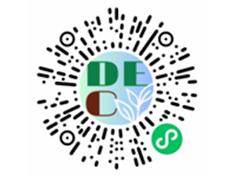

# DEC Sustainable Diet Assistant

## Project Introduction
This project is named `DEC: Sustainable Diet Assistant`, where `DE` stands for decrease and `C` stands for carbon. The project name reflects its core philosophy: achieving sustainable development by minimizing the carbon footprint of dietary activities.
This is a purely public welfare project developed by undergraduate students from the School of Software at Tsinghua University.

## How to Access


## Project Services
This project provides the following services:
+ Scientific calculation of food carbon emissions
+ Personalized recipe recommendations
+ Nutritional goals tailored to each user
+ Household diet management
+ Sustainable diet exchange platform

## Project Directory
```
~/
├── README.md         
├── document/         # Project documentation
├── frontend/         # Frontend
├── backend/          # Backend
├── internal_cross/   # Prototype files
├── model/            # Models
├── static/           # Static files
```

## Current Work
We are currently adding AI-assisted features to our services.
For details on the models we use, please refer to the `model/` directory:

## Filing Information
Domain list: `www.dechelper.com`

## License
MIT License
